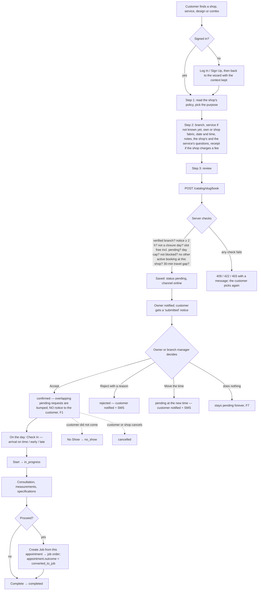
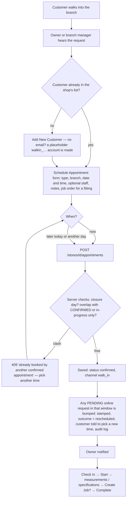
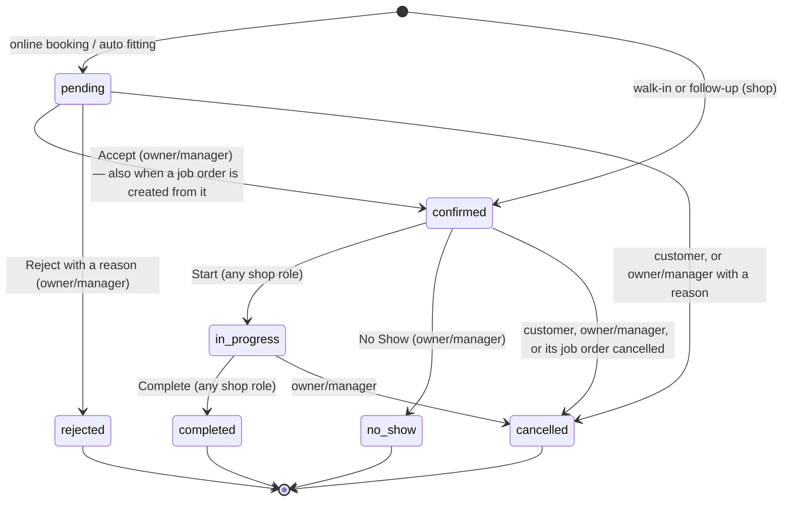

# SUTURA appointments — real-life workflow audit (Online booking vs Walk-in)

Audit date **2026-10-15**. Read-only: no application code, data or git history was changed to write this.
Every claim below is tagged:

- **✅ Verified** — read in the code at the line given in §14.
- **🧪 Verified + tested** — read in the code and confirmed with a rolled-back test or an API call.
- **📄 Plan** — what a plan document says (not proof that it works).
- **💭 Interpretation** — my reading of what it means for a real shop.
- **❓ Unverified** — not established by the code or the history.

Paths are relative to `sutura-server/` (PHP) and `sutura-client/` (TypeScript) unless written in full.

---

## 1. Executive summary

**How a Davao tailoring shop uses SUTURA appointments today**

1. **Online customer.** A signed-in customer picks a shop, service, design or combo, goes through a 3-step wizard
   (purpose → branch, date and time, questions → review). The booking is saved as **`pending`**. The shop owner (or
   the branch manager) **accepts** it (`confirmed`) or **rejects** it with a reason. On the day, staff **check the
   customer in**, **start** the session (`in_progress`), take measurements and specifications, optionally **create a
   job order from it**, then **complete** it. Booking never creates a job order, never confirms production, and never
   collects the job's down payment on its own. ✅
2. **Walk-in.** The owner or branch manager enters the visit from the Appointments page. It is saved as
   **`confirmed`** straight away, with `intake_channel = walk_in`, and it **takes priority over any pending online
   request** for the same time (*"kung sino ang makauna"*). The online customer is told to pick another time. Plain
   staff cannot create a walk-in; they can only book a **follow-up** visit. ✅

**What Bongo's appointment work in git actually is.** In git, Bongo (leader) has **one appointment change**: the
**2-hour minimum notice** for online bookings and for a customer moving their own request
(`Appointment::MIN_BOOKING_LEAD_MINUTES = 120`, commit `cd20690`, plus the matching greyed-out times in the calendar,
commit `e675310`, both 2026-10-13). Everything else in the appointment system (statuses, conflict rules, walk-in
priority, travel buffer, early arrival, reject with reason, follow-ups, job-order link) was written in Joshua's commits
from June to October 2026. The team's notes say Bongo built a fuller appointment flow on his own machine; **it is not
in git**, so it cannot be audited here. ✅ / ❓

**Most important findings**

| #  | Finding                                                                                                                                                                                                                                            | Effect in a real shop                                                                                                                               |
| -- | -------------------------------------------------------------------------------------------------------------------------------------------------------------------------------------------------------------------------------------------------- | --------------------------------------------------------------------------------------------------------------------------------------------------- |
| F1 | 🧪 **Accepting, starting or marking a no-show does not notify anyone.** `AppointmentController::update()` checks for a status change *after* saving, when Laravel's `getOriginal()` already holds the new value (line 826).            | The customer is **not told** when the shop accepts their booking, by app, email or SMS. The thesis requires an approval SMS on authorization. |
| F2 | ✅ The online booking **API does not require login**. It books under whatever email is sent and creates an account if that email is new (`PublicBookingController.php:223`). The website itself always asks the customer to sign in first. | Someone calling the API directly could put a booking on another person's account. Not reachable through the normal screens.                         |
| F3 | ✅ A **branch manager's walk-in is not limited to their own branch**. `store()` has no `branchAccessDenied` check, although every other appointment action does.                                                                         | A branch manager could book a walk-in at another branch.                                                                                            |
| F4 | ✅ **A no-show can be recorded two ways**: status `no_show` (list button), or **Complete** with outcome "No Show" (status `completed`, and only after the session was *started*).                                                | Reports and the customer's history disagree on what happened.                                                                                       |
| F5 | ✅ **Session lengths differ by who books**: online Measurement 45 min, Fitting 45, Pickup 15; walk-in Measurement 60, Fitting 60, Pickup 30.                                                                                                 | The same visit blocks the calendar for a different length depending on the channel.                                                                 |
| F6 | ✅ The **automatic fitting booking** (made when a job reaches Ready for Fitting) is saved as `pending`, `walk_in`, at tomorrow **10:00**.                                                                                          | It blocks that online time slot, and it is counted as a walk-in in reports.                                                                         |
| F7 | ✅ **Pending requests never expire.** The plan's 24-hour auto-cancel is not built.                                                                                                                                                           | A request the shop forgets keeps its slot locked for online customers.                                                                              |

---

## 2. Repository state and commit identification

|                                  | `sutura-client`                                                        | `sutura-server`             |
| -------------------------------- | ------------------------------------------------------------------------ | ----------------------------- |
| Branch                           | `feature/ordering-flow`                                                | `feature/ordering-flow`     |
| HEAD                             | `af6e85c` (2026-10-15)                                                 | `2eaddd8` (2026-10-15)      |
| `origin/main`                  | `6f09b01` = merge of PR #32                                            | `a0be6e0` = merge of PR #34 |
| Code difference HEAD vs `main` | **0 files** (same code)                                            | **0 files** (same code) |
| Uncommitted work                 | only `docs/Sutura_Research Analysis/` (untracked, left out on purpose) | none                          |

So **"the current commit" = what is on `main` today**, in both repos. ✅

---

## 3. Bongo's appointment implementation and the git history

### 3.1 Every commit by Bongo (`jossua2602` / "Jossua A. Bongo"), all branches ✅

| Repo   | Commit      | Date       | Message                                                | Appointment content                                                                                                                                                                                                                                                                                                                                                                                                                       |
| ------ | ----------- | ---------- | ------------------------------------------------------ | ----------------------------------------------------------------------------------------------------------------------------------------------------------------------------------------------------------------------------------------------------------------------------------------------------------------------------------------------------------------------------------------------------------------------------------------- |
| client | `e675310` | 2026-10-13 | Customer, map, storefront and admin updates (95 files) | `src/components/shared/InteractiveCalendar.tsx`: `MIN_BOOKING_LEAD_MINUTES = 120`; past and "too soon" times are **greyed out instead of hidden**; message "appointments need at least 2 hours' notice" (public mode only; walk-in mode blocks only past times). `src/app/account/appointments/page.tsx`: empty-state link `/stores` → `/map`.                                                                           |
| client | `b48adfa` | 2026-10-13 | Update Impeccable design skill to v4.5.2               | none                                                                                                                                                                                                                                                                                                                                                                                                                                      |
| client | `6b5c66e` | 2026-10-13 | Merge pull request #31                                 | (merge)                                                                                                                                                                                                                                                                                                                                                                                                                                   |
| server | `cd20690` | 2026-10-13 | latest update (38 files)                               | `app/Models/Appointment.php`: new constant `MIN_BOOKING_LEAD_MINUTES = 120` ("walk-ins created at the counter are exempt"). `PublicBookingController::submit` and `AppointmentController::rescheduleMine`: `scheduled_at` must be ≥ now + 120 min ("Please choose a time at least 2 hours from now"). Other files in this commit (admin, subscriptions, custom apparel types, audit-log actor role) are not appointment logic. |
| server | `a0a77bc` | 2026-10-13 | Merge pull request #33                                 | (merge)                                                                                                                                                                                                                                                                                                                                                                                                                                   |

### 3.2 Who wrote the rest (git blame on `app/Models/Appointment.php`) ✅

| Rule                                                                           | Line      | Commit      | Author / date                         |
| ------------------------------------------------------------------------------ | --------- | ----------- | ------------------------------------- |
| Status transition table `TRANSITIONS`                                        | 82        | `2432657` | Joshua, 2026-06-21                    |
| Branch time-slot conflict `hasSchedulingConflict`                            | 253       | `4732117` | Joshua, 2026-07-10                    |
| Walk-in preemption `getOverlappingPendingAppointments` / `preemptByWalkIn` | 375 / 412 | `cc04b9e` | Joshua, 2026-09-15                    |
| One active booking per shop, rebooking block                                   | 346 / 360 | `a141591` | Joshua, 2026-09-25                    |
| 30-minute travel buffer, arrival statuses                                      | 56 / 67   | `5fb8b31` | Claude (Joshua's session), 2026-09-28 |
| `rejected` status, rejection reasons                                         | 89 / 37   | `9a41cb3` | Joshua, 2026-10-01                    |
| **2-hour minimum notice**                                                | 64        | `cd20690` | **Bongo, 2026-10-13**           |

### 3.3 What the history cannot show ❓

- The team's own notes (2026-10-11) say Bongo "finished the appointment flow locally, not pushed yet". **No such commit
  exists** on any branch of either repo, so that work is **not part of this audit**.
- The plan folder `SUTURA/appointment/` (dated 2026-10-03) is **outside both repositories**, so its author cannot be
  verified from git.

---

## 4. The plan and business requirements that were compared

| Source                                                                                             | Status            | What it asks for (appointment part)                                                                                                                                                                                                                                                                                                                                                                                                                                                                                                                                                                 |
| -------------------------------------------------------------------------------------------------- | ----------------- | --------------------------------------------------------------------------------------------------------------------------------------------------------------------------------------------------------------------------------------------------------------------------------------------------------------------------------------------------------------------------------------------------------------------------------------------------------------------------------------------------------------------------------------------------------------------------------------------------- |
| **Approved thesis** `sutura-client/suturathesisapproved.txt` lines 161–162, 179, 355, 388 | 📄 binding        | **Customer**: Book Appointment (customer info, purpose, date & time) with an automatic **Check Availability**; Cancel; Request Reschedule. **Shop Owner**: Manage Shop Schedule; **Authorize Appointment → triggers an SMS confirmation**. If no tailor is available: owner logs a reason and **suggests a new time** → SMS → customer **accepts (picks a new slot) or declines (cancellation SMS)**. **Staff**: "appointment-based order intake … create job orders directly from scheduled fittings". **The thesis never mentions walk-ins.** |
| `sutura-client/docs/APPOINTMENT-JOB-PAYMENT-TO-BE.md` (2026-10-01, in git)                       | 📄 + built record | Appointment, job order and payment are three separate records; adds `rejected` with reasons; owner "Needs your decision" queue; assignment of staff; phases 1–5 marked built.                                                                                                                                                                                                                                                                                                                                                                                                                    |
| `sutura-client/docs/APPOINTMENT-ONLINE-WALKIN-FLOW.md` (2026-09-30, in git)                      | 📄 + built record | Online = `pending` until accepted; walk-in = `confirmed` at once; walk-in wins the slot; preempted customer can pick a new time. Still accurate, except that it says a design's Measurement is 60 min (the wizard now sends 45, see F5).                                                                                                                                                                                                                                                                                                                                                        |
| `SUTURA/appointment/` folder (2026-10-03, outside git)                                           | 📄 detailed spec  | Rules checked below: `BR-PHYSICAL-COUNTER-PRIORITY`, `BR-STATUS-AND-SLOT-STATES` (P-1 24-h pending expiry, BR-S3 reason required), `BR-BUFFER-AND-TRAVEL` (P-5a–d), `CAPACITY-AND-CONCURRENCY` (BR-R1 / P-11 staff-based capacity), `POLICY-NO-SHOW-AND-GRACE-PERIOD` (P-12 15-min grace), `CUSTOMER-ANTI-ABUSE-AND-LIMITS` (P-2 2 pending, P-13 3-strike), `RBAC-APPOINTMENT-MATRIX`, `CUSTOMER-IDENTITY-AND-AUTH`.                                                                                                                                                               |

**The four records in a real shop (kept separate in SUTURA)** ✅

| Record                                               | Real-life meaning                                        | In SUTURA                                                                                                                                                    |
| ---------------------------------------------------- | -------------------------------------------------------- | ------------------------------------------------------------------------------------------------------------------------------------------------------------ |
| **Appointment**                                | "Punta ka sa shop sa Sabado, 10 AM" — a scheduled visit | `appointments` row; statuses in §8                                                                                                                        |
| **Consultation, specifications, measurements** | What happens *during* the visit                        | notes, `answers` (service questions), reference photos and link, **Record measurements** (a separate `measurements` record)                        |
| **Job order**                                  | The work the shop accepts to produce                     | `job_orders` row, created **from** the appointment (`appointment_id`), never automatically by booking                                              |
| **Payment**                                    | Money changing hands                                     | the optional **booking/fitting fee** lives on the appointment (`payment_status`); the job's **down payment** lives on the job order's payments |

---

## 5. Online customer booking — real-life workflow

| Step                | Customer does                                                                                                                                      | System does                                                                                                                                                                                                                                                                                                                                                                                                                                                                                                                              | Shop does                                                                                                                                                                                                                                                                                         | Data                                                                                                         | Rule (✅)                                                                                                                    | On failure / next                                                                                                                        |
| ------------------- | -------------------------------------------------------------------------------------------------------------------------------------------------- | ---------------------------------------------------------------------------------------------------------------------------------------------------------------------------------------------------------------------------------------------------------------------------------------------------------------------------------------------------------------------------------------------------------------------------------------------------------------------------------------------------------------------------------------- | ------------------------------------------------------------------------------------------------------------------------------------------------------------------------------------------------------------------------------------------------------------------------------------------------- | ------------------------------------------------------------------------------------------------------------ | ---------------------------------------------------------------------------------------------------------------------------- | ---------------------------------------------------------------------------------------------------------------------------------------- |
| 1. Find             | opens a shop, service, design or combo page, taps Book                                                                                             | keeps the context in the URL (`service_id`, `ref_item_id`, `package_id`)                                                                                                                                                                                                                                                                                                                                                                                                                                                           | —                                                                                                                                                                                                                                                                                                | —                                                                                                           | —                                                                                                                           | → wizard                                                                                                                                |
| 2. Sign in          | logs in or registers                                                                                                                               | redirects to `/login?redirect=…` (or the sign-in pop-up on tablet/desktop) and returns with the context                                                                                                                                                                                                                                                                                                                                                                                                                               | —                                                                                                                                                                                                                                                                                                | —                                                                                                           | `useBookingWizard.ts:27-52`                                                                                                | the wizard never shows to a guest                                                                                                        |
| 3. Purpose          | picks Consultation, Measurement, Alteration, Other…                                                                                               | offers purposes by context: a **design** gives Consultation or Measurement; an **alterations** combo gives Alteration; **Fitting and Pickup** appear only when the customer *says* they already have an order (a toggle in Step 1, or a fitting/pickup link) — not checked against their real orders (`withExisting`, lines 123, 228)                                                                                                                                                                             | —                                                                                                                                                                                                                                                                                                | `appointment_type`, `purpose_label` (Other)                                                              | durations: Consultation 30, Measurement 45, Alteration 30, Fitting 45, Pickup 15, Other 30 (`useBookingWizard.ts:186-362`) | —                                                                                                                                       |
| 4. Details and time | branch (nearest pre-selected), service if not known yet, fabric source, date and time, notes, questions, receipt if the shop charges a fitting fee | calendar shows times inside the shop's weekly hours; taken, past and "too soon" (< 2 h) times are greyed out                                                                                                                                                                                                                                                                                                                                                                                                                             | —                                                                                                                                                                                                                                                                                                | `store_branch_id`, `service_id`, `scheduled_at`, `answers`, `reference_images/link`, `payment_*` | required service questions block Next                                                                                        | → review                                                                                                                                |
| 5. Submit           | confirms on the review step                                                                                                                        | `PublicBookingController::submit` (no login required on the server, F2). Checks, in order: a verified branch exists; fields valid; time ≥ now + 120 min; Measurement/Alteration need a service; GCash/PayMaya need a receipt; not a closure day; **no overlap with pending, confirmed or in-progress** at that branch; **daily cap**; customer not blocked; **one active booking per shop**; **30-min travel gap** to the customer's other bookings anywhere. Saves inside a transaction (rechecks the slot). | —                                                                                                                                                                                                                                                                                                | `status = pending`, `intake_channel = online`, `payment_status = pending`                              | lines 99–333                                                                                                                | each failure returns a clear message (409/422/403) and nothing is saved                                                                  |
| 6. Notices          | sees "The store will confirm your booking shortly."                                                                                                | owner gets `AppointmentBookedNotification`; customer gets "submitted" (app + email)                                                                                                                                                                                                                                                                                                                                                                                                                                                    | sees it in Appointments and in Home's **Needs your decision**                                                                                                                                                                                                                               | —                                                                                                           | lines 320, 327; `DecisionQueueController.php:28`                                                                           | —                                                                                                                                       |
| 7. Decision         | waits                                                                                                                                              | —                                                                                                                                                                                                                                                                                                                                                                                                                                                                                                                                       | **Accept** (`PUT …/appointments/{id}` `status=confirmed`): rechecks against confirmed/in-progress; bumps any other overlapping pending request. **Reject** (`POST …/reject`) needs a reason code. **Move** (edit time) rechecks the slot. Owner or branch manager only. | status, `rejection_reason_code/note`, notes stamped "[Rescheduled from …]"                                | `update()` 610+, `reject()` 1049                                                                                         | **F1:** accepting sends no notice. Reject and move do notify (in-app, email, and SMS when the shop has text messages switched on). |
| 8. Before the visit | can **cancel** (pending/confirmed) or **pick a new time** (pending only)                                                               | 24-h reminder (hourly job) for pending and confirmed                                                                                                                                                                                                                                                                                                                                                                                                                                                                                     | —                                                                                                                                                                                                                                                                                                | `reminder_sent_at`                                                                                         | `cancelMine` 180, `rescheduleMine` 222 (same checks as booking, 2 h notice)                                              | a confirmed booking cannot be moved by the customer; they cancel and rebook                                                              |
| 9. Arrival          | arrives                                                                                                                                            | —                                                                                                                                                                                                                                                                                                                                                                                                                                                                                                                                       | **Check In**: records `checked_in_at`; server marks `on_time` / `early` / `late` (±5 min). If early: **Accommodate now** (only if the branch is free until the booked time) or **Ask to wait**. Status stays `confirmed`.                                            | `arrival_status`, `early_arrival_decision`, `actual_service_start_at`                                  | `update()` 702–750                                                                                                        | —                                                                                                                                       |
| 10. Session         | talks with the tailor                                                                                                                              | —                                                                                                                                                                                                                                                                                                                                                                                                                                                                                                                                       | **Start** → `in_progress`; staff may **Record measurements**, share a link or photos with the customer, and **Create Job**                                                                                                                                                   | `measurements` record; job order with `appointment_id`; reference photos carried over                    | `JobOrderController.php:686-762`                                                                                           | staff may create the job only from an approved appointment in their own branch (line 607)                                                |
| 11. Close           | —                                                                                                                                                 | sends "completed" notice                                                                                                                                                                                                                                                                                                                                                                                                                                                                                                                 | **Complete** with an outcome; a Fitting or Pickup must name a job order                                                                                                                                                                                                                     | `status = completed`, `outcome`, `fitting_notes` (copied to the job)                                   | `complete()` 852–950                                                                                                      | the job order chosen here is **not saved on the appointment** (only in the audit log)                                              |

---

## 6. Shop-owner walk-in — real-life workflow

**Who can do what at the counter** ✅

| Action                                                                                                                   | Owner |           Branch manager           |                                                     Staff                                                     |
| ------------------------------------------------------------------------------------------------------------------------ | :---: | :--------------------------------: | :-----------------------------------------------------------------------------------------------------------: |
| Create a walk-in (`POST …/appointments`, route group `role:store_owner,branch_manager`, `routes/api.php:315/364`) |  ✅  | ✅ (not limited to own branch, F3) |                                                      ❌                                                      |
| Schedule a **follow-up** (`POST …/appointments/follow-up`, line 270)                                            |  ✅  |                 ✅                 |                                                      ✅                                                      |
| Check in, accommodate early, Start, Complete                                                                             |  ✅  |          ✅ (own branch)          |                                                ✅ (own branch)                                                |
| Confirm, reject, cancel, reschedule, no-show, assign staff, verify fee                                                   |  ✅  |          ✅ (own branch)          | ❌ (`$staffAllowed = in_progress, completed`, line 962; staff time/notes/staff edits are dropped, line 639) |
| Create a job order from the appointment                                                                                  |  ✅  |                 ✅                 |                   ✅ only from an approved appointment in their branch, one per appointment                   |

| Step                        | Shop does                                                                                                                                                          | System does                                                                                                                                                                                                                 | Data                                       | Rule (✅)                                                                                                                                                                                                                             |
| --------------------------- | ------------------------------------------------------------------------------------------------------------------------------------------------------------------ | --------------------------------------------------------------------------------------------------------------------------------------------------------------------------------------------------------------------------- | ------------------------------------------ | ------------------------------------------------------------------------------------------------------------------------------------------------------------------------------------------------------------------------------------- |
| 1. Arrival                  | greets the customer                                                                                                                                                | —                                                                                                                                                                                                                          | —                                         | —                                                                                                                                                                                                                                    |
| 2. Request                  | finds the customer or adds a new one                                                                                                                               | `POST /stores/{id}/customers`; no email → placeholder `walkin_…@sutura.com`                                                                                                                                           | customer record                            | `CustomerController.php:64`, `AuthController.php:39-42`                                                                                                                                                                           |
| 3. Can we take them?        | looks at the calendar (walk-in mode: only past times are greyed out; **no 2-hour rule**)                                                                     | —                                                                                                                                                                                                                          | —                                         | `AppointmentCreateModal.tsx:253`                                                                                                                                                                                                    |
| 4. Record                   | fills type, branch, date and time, optional staff (must be from that branch), notes, job order for a fitting                                                       | duration is filled from the type: Consultation 30, Measurement 60, Fitting 60, Alteration 30, Pickup 30, Other 30                                                                                                           | `TYPE_DEFAULT_DURATIONS` (model line 24) | date must be today or later (`StoreAppointmentRequest.php:39`)                                                                                                                                                                      |
| 5. Save                     | —                                                                                                                                                                 | `status = confirmed`, `intake_channel = walk_in`                                                                                                                                                                        | lines 451–452                             | **checked:** closure day; overlap with **confirmed/in-progress only**. **Not checked:** daily cap, 2-h notice, one-active-per-shop, customer travel gap, weekly opening hours, a service for Measurement/Alteration |
| 6. Conflicts                | —                                                                                                                                                                 | every overlapping **pending online** request is bumped (`preemptByWalkIn`): note stamp, `outcome = rescheduled`, customer notice "claimed by an in-store walk-in", audit log `appointment_preempted_by_walk_in` | lines 459–476; model 412                  | the online request **stays pending**; its customer can pick a new time                                                                                                                                                          |
| 7. Fitting fee              | —                                                                                                                                                                 | an extra fitting on a job beyond the shop's `fitting_limit` adds the fitting fee to the job balance                                                                                                                       | lines 478–497                             | —                                                                                                                                                                                                                                    |
| 8. Outcome for the customer | **now**: served at once; **later**: a confirmed slot (still labelled walk-in); **cannot**: the form refuses the time (409), so they pick another | —                                                                                                                                                                                                                          | —                                         | there is **no "turned away" or waiting-list record**                                                                                                                                                                            |
| 9. The session              | Check In → Start → measurements and specifications → Create Job (optional) → Complete                                                                          | same as online steps 9–11                                                                                                                                                                                                  | —                                         | —                                                                                                                                                                                                                                    |

**How a walk-in differs from an online booking** — see §9.

---

## 7. Frontend-to-backend code trace

**Online**

| Layer                     | Where                                                                                                                                                                                                                                                                                                                   |
| ------------------------- | ----------------------------------------------------------------------------------------------------------------------------------------------------------------------------------------------------------------------------------------------------------------------------------------------------------------------- |
| Pages                     | `src/app/store/[store_id]/book/page.tsx`; steps in `src/components/booking/steps/*`                                                                                                                                                                                                                                 |
| State and submit          | `src/components/booking/hooks/useBookingWizard.ts` — login gate 27–52, purposes and durations 186–362, settings `GET /catalog/{slug}/booking-settings` 478, submit `POST /catalog/{slug}/book` 578                                                                                                             |
| Calendar                  | `src/components/shared/InteractiveCalendar.tsx` — `MIN_BOOKING_LEAD_MINUTES` 23, "too soon" slots 204 (Bongo, `e675310`); taken slots from `GET /catalog/{slug}/appointments` (anonymous: time, duration, branch only)                                                                                         |
| Routes (public, no login) | `routes/api.php:98` settings, `:99` taken slots, `:103` book (`throttle:10,1`)                                                                                                                                                                                                                                  |
| Controller                | `PublicBookingController::submit` 99–333                                                                                                                                                                                                                                                                             |
| Customer's own            | `GET /my-appointments` (172), `DELETE /my-appointments/{id}` (179, `cancelMine`), `PUT /my-appointments/{id}/reschedule` (181, `rescheduleMine`); UI `src/app/account/appointments/[id]/page.tsx:42`, `src/components/account/appointments/RescheduleAppointmentModal.tsx:77`, `AppointmentCard.tsx:28` |

**Shop side (owner, branch manager, staff)**

| Action             | UI call (`src/components/appointments/useAppointments.ts`)                                | Route (`routes/api.php`)                                 | Controller (`AppointmentController.php`)                                                   |
| ------------------ | ------------------------------------------------------------------------------------------- | ---------------------------------------------------------- | -------------------------------------------------------------------------------------------- |
| List               | page load                                                                                   | `GET /stores/{store}/appointments` :258 (all shop roles) | `index` 357 (branch-scoped for manager and staff)                                          |
| Walk-in create     | `POST …/appointments` :257                                                               | :364 (owner, manager)                                      | `store` 435                                                                                |
| Follow-up          | `POST …/appointments/follow-up` :227                                                     | :270 (all shop roles)                                      | `createFollowUp` 527 (status `confirmed`, channel `walk_in`, sends "confirmed" notice) |
| Accept             | `PUT …/{id}` `{status:'confirmed'}` :112                                               | :259                                                       | `update` 610                                                                               |
| Start / No-show    | `PUT …/{id}` `{status}` :161 (page.tsx 461, 467)                                       | :259                                                       | `update`                                                                                   |
| Check in           | `PUT …/{id}` `{checked_in_at}` :177                                                    | :259                                                       | `update` 702                                                                               |
| Early arrival      | `PUT …/{id}` `{early_arrival_decision}` :194 / :208                                    | :259                                                       | `update` 721                                                                               |
| Complete           | `POST …/{id}/complete` :295                                                              | :260                                                       | `complete` 852                                                                             |
| Cancel             | `DELETE …/{id}` (reason, optional block) :322                                            | :365 (owner, manager)                                      | `destroy` 989                                                                              |
| Reject             | `POST …/{id}/reject` :128                                                                | :367 (owner, manager)                                      | `reject` 1049                                                                              |
| Assign staff       | `PUT …/{id}/assign` :144                                                                 | :372 (owner, manager)                                      | `assign` 1089                                                                              |
| Verify booking fee | `PUT …/{id}/verify-payment`                                                              | :373 (owner, manager)                                      | `verifyPayment` 1141                                                                       |
| Create job from it | Create Job button (`AppointmentActionModals.tsx:412`) → job form with `appointment_id` | `POST …/jobs`                                           | `JobOrderController::store` 596–607, 686–762                                             |
| Owner's queue      | Home                                                                                        | `GET …/decision-queue` :366                             | `DecisionQueueController.php:28` (pending appointments)                                    |

**Background jobs.** `app:remind-upcoming-appointments` hourly (`routes/console.php:32`): pending and confirmed bookings
23–25 h ahead (`RemindUpcomingAppointments.php:22`). There is **no automatic no-show** and **no pending expiry**. ✅

**Notices** (`app/Notifications/AppointmentStatusNotification.php:48`): in-app always; email unless the address is a
`walkin_…` placeholder; **SMS** (sent through the shop's text-message outbox, so only when the shop has texts switched on) only for the events that have a template (`app/Services/Sms/SmsTemplates.php:59-64`):
confirmed, rejected, rescheduled, cancelled (plus the 24-h reminder). ✅

---

## 8. Appointment statuses and transition rules

`Appointment::TRANSITIONS` (model line 82) is the rule; terminal states cannot change (`isTerminal`). ✅

**Fields that are *not* statuses** ✅

| Field                      | Values                                                                                                                     | Set by                                                         |
| -------------------------- | -------------------------------------------------------------------------------------------------------------------------- | -------------------------------------------------------------- |
| `outcome`                | `completed`, `rescheduled` (= "needs a new time" after being bumped), `no_show`, `converted_to_job`, `cancelled` | preemption, Complete form, job creation                        |
| `arrival_status`         | `on_time`, `early`, `late` (±5 min)                                                                                 | Check In (server-derived)                                      |
| `early_arrival_decision` | `waiting`, `accommodated`, `declined`                                                                                | shop (`declined` exists but no screen sets it ❓)            |
| `payment_status`         | `pending`, `paid`, `rejected`                                                                                        | booking fee only; owner/manager verifies                       |
| `rebooking_blocked`      | true / false                                                                                                               | owner/manager cancel with "block rebooking"                    |
| `intake_channel`         | `online`, `walk_in` (column default `walk_in`)                                                                       | online booking / every shop-created and system-created booking |

---

## 9. Online vs Walk-in comparison

|                                          | Online booking                                                                                                    | Walk-in                                                           |
| ---------------------------------------- | ----------------------------------------------------------------------------------------------------------------- | ----------------------------------------------------------------- |
| Who starts it                            | the customer                                                                                                      | the owner or branch manager (staff: follow-up only)               |
| Who types the data                       | the customer (wizard)                                                                                             | the shop (Schedule Appointment form)                              |
| Login                                    | required by the website; **not** by the API (F2)                                                            | shop login; customer needs no account (placeholder)               |
| First status                             | `pending`                                                                                                       | `confirmed`                                                     |
| Notice needed                            | ≥ 2 hours (Bongo)                                                                                                | none (today or later)                                             |
| Slot check                               | blocks on **pending**, confirmed, in-progress                                                               | blocks on confirmed and in-progress only; **bumps** pending |
| Daily cap (`max_appointments_per_day`) | yes                                                                                                               | no                                                                |
| One active booking per shop              | yes                                                                                                               | no                                                                |
| 30-min travel gap to other bookings      | yes                                                                                                               | no                                                                |
| Closure days                             | yes                                                                                                               | yes                                                               |
| Weekly opening hours                     | calendar only (server does not check)                                                                             | calendar only                                                     |
| Duration                                 | from the wizard (Measurement 45, Fitting 45, Pickup 15)                                                           | from the server (Measurement 60, Fitting 60, Pickup 30) — F5     |
| Booking / fitting fee                    | shown when the shop has a fitting fee; receipt for GCash/PayMaya                                                  | not asked                                                         |
| Notices                                  | owner: new booking; customer: submitted / rejected / moved / cancelled / completed — **not accepted** (F1) | owner: new booking; customer: none at creation (they are there)   |
| Branch limit for managers                | n/a                                                                                                               | not enforced (F3)                                                 |

---

## 10. Current implementation vs the plan

Status: **Implemented** · **Partial** · **Missing** · **Contradictory** · **Unverified**. "Bongo" lists his verifiable
contribution.

| Requirement                                                                       | Real-life expectation               | Bongo                 | Current code                                                                                                                  | Evidence                                                         | Status                          | Effect                                                     | Gap / clarification                                                                                      |
| --------------------------------------------------------------------------------- | ----------------------------------- | --------------------- | ----------------------------------------------------------------------------------------------------------------------------- | ---------------------------------------------------------------- | ------------------------------- | ---------------------------------------------------------- | -------------------------------------------------------------------------------------------------------- |
| Book with info, purpose, date & time (thesis)                                     | customer requests a visit           | —                    | 3-step wizard                                                                                                                 | `useBookingWizard.ts` 578                                      | Implemented                     | —                                                         | —                                                                                                       |
| Check availability (thesis)                                                       | can't pick a taken time             | 2-h notice greying    | calendar + server overlap, closures, daily cap                                                                                | `PublicBookingController` 189–212                             | Implemented                     | —                                                         | weekly hours checked on the client only (by design, comment `AppointmentController.php:51`)            |
| **Authorize → SMS confirmation** (thesis)                                  | customer gets a text "CONFIRMED"    | —                    | template exists; `update()` never sends it                                                                                  | `AppointmentController.php:826`; `SmsTemplates.php:60`       | **Contradictory**         | customer is not told                                       | F1                                                                                                       |
| No tailor → reason + suggest a new time → customer accepts or declines (thesis) | shop proposes another time          | —                    | Reject (terminal, with reason) **or** owner moves the time (notice + SMS); customer can pick another time while pending | `reject()` 1049; `update()` 644–690; `rescheduleMine` 222 | Partial                         | no single "suggest a time, customer accepts/declines" step | decide whether Reject should carry a suggested time                                                      |
| Cancel / Request reschedule (thesis)                                              | customer can back out or move       | 2-h notice on moving  | cancel (pending, confirmed); move (pending only)                                                                              | `cancelMine` 180, `rescheduleMine` 222                       | Partial                         | a confirmed booking can't be moved by the customer         | intended?                                                                                                |
| Staff create job orders from scheduled fittings (thesis)                          | tailor opens the job at the counter | —                    | yes, approved appointment, own branch, once                                                                                   | `JobOrderController.php:596-607`                               | Implemented                     | —                                                         | —                                                                                                       |
| Walk-in priority (`BR-PHYSICAL-COUNTER-PRIORITY`)                               | person at the counter wins          | —                    | walk-in confirmed; pending bumped and notified                                                                                | `store()` 459–476, model 412                                  | Implemented                     | —                                                         | bump message also sent when the bump is caused by *accepting* another request (wording says "walk-in") |
| 2-hour notice (`cd20690`)                                                       | shop gets time to prepare           | **Implemented** | online + customer move; walk-in exempt                                                                                        | model 64; `PublicBookingController` 126                        | Implemented                     | —                                                         | —                                                                                                       |
| Pending expires after 24 h (P-1)                                                  | forgotten requests release the slot | —                    | not built                                                                                                                     | no command in `routes/console.php`                             | Missing                         | slot stays locked                                          | F7                                                                                                       |
| ≤ 2 pending requests platform-wide (P-2)                                         | stop spam across shops              | —                    | 1 active (pending/confirmed) **per shop**; no platform cap                                                              | model 346                                                        | Contradictory                   | a customer can hold pending requests at many shops         | choose one rule                                                                                          |
| 15-min cleanup between sessions, same branch (P-5a)                               | tailor resets the station           | —                    | not built (back-to-back allowed)                                                                                              | model 253                                                        | Missing                         | —                                                         | —                                                                                                       |
| 30-min inter-branch / 45-min cross-district travel (P-5b/d)                       | Toril → Buhangin takes time        | —                    | flat 30 min, any shop (P-5c only)                                                                                             | model 56, 312                                                    | Partial                         | —                                                         | —                                                                                                       |
| Branch capacity = on-duty staff (BR-R1 / P-11)                                    | 2 tailors = 2 customers at once     | —                    | **1 booking per time window per branch**, whatever the staff count; plus an optional daily cap                          | model 253; `PublicBookingController` 208                       | Contradictory                   | a 2-tailor branch turns away a second customer             | decide the capacity rule                                                                                 |
| 15-min grace, then no-show (P-12)                                                 | wait 15 min before giving up        | —                    | arrival marked late after **5** min; no-show is manual                                                                  | `update()` 702                                                 | Contradictory                   | —                                                         | 5 or 15?                                                                                                 |
| Staff may declare a no-show (no-show policy §2)                                  | the tailor on duty marks it         | —                    | staff **cannot** (only in_progress/completed)                                                                           | `AppointmentController.php:962`                                | Contradictory                   | a branch with only staff on duty can't close a no-show     | —                                                                                                       |
| 3 no-shows in 90 days block online booking (P-13)                                 | protects the shop's time            | —                    | not built; block only by a manual cancel                                                                                      | model 360                                                        | Missing                         | —                                                         | —                                                                                                       |
| Reason required to reject (BR-S3)                                                 | customer knows why                  | —                    | reason code required                                                                                                          | `reject()` 1049                                                | Implemented                     | —                                                         | —                                                                                                       |
| Branch isolation for managers (RBAC)                                              | a manager runs only their branch    | —                    | all actions except **walk-in create**                                                                                   | `branchAccessDenied` 32; `store()` 435                       | Partial                         | F3                                                         | —                                                                                                       |
| Customer must be signed in to book (`CUSTOMER-IDENTITY-AND-AUTH`)               | real accounts only                  | —                    | website: yes; API: no                                                                                                         | `useBookingWizard.ts:52`; `routes/api.php:103`               | Partial                         | F2                                                         | —                                                                                                       |
| Staff: check-in and early-arrival handling (RBAC)                                 | the tailor does it                  | —                    | allowed                                                                                                                       | `update()` (no staff restriction on these fields)              | Implemented                     | —                                                         | —                                                                                                       |
| Walk-in record for "can't take you now"                                           | shop logs a turned-away customer    | —                    | no such record                                                                                                                | —                                                               | Missing (not in any plan)       | —                                                         | optional                                                                                                 |
| Follow-up visit by staff ("balik po kayo Friday")                                 | tailor books the return visit       | —                    | built (all shop roles), confirmed, notifies customer                                                                          | `createFollowUp` 527                                           | Implemented (beyond the thesis) | —                                                         | —                                                                                                       |

**In code but not in the thesis:** walk-ins and preemption; follow-ups by staff; early-arrival accommodation; the
30-minute travel buffer; the per-shop single-active-booking rule; booking-fee verification; the automatic fitting
booking; the daily cap. ✅

---

## 11. Scenario walkthroughs (from the real code)

### Scenario A — Ana, Matina: a barong for her son's graduation (online)

| # | Actor         | Action                                                                                                             | System response                                                                                                                               | Data / status                                                | Next                                                                           | Evidence                                  |
| - | ------------- | ------------------------------------------------------------------------------------------------------------------ | --------------------------------------------------------------------------------------------------------------------------------------------- | ------------------------------------------------------------ | ------------------------------------------------------------------------------ | ----------------------------------------- |
| 1 | Ana           | opens Thread & Needle's "Barong Tagalog Tailoring" service and taps Book                                           | not signed in → Log In page, then back to the wizard                                                                                         | —                                                           | wizard                                                                         | `useBookingWizard.ts:52`                |
| 2 | Ana           | picks **Consultation**, the Poblacion branch, Saturday 10:00, notes "slim fit, white piña", uploads a photo | the calendar shows 10:00 free; times within 2 h of now are greyed out                                                                         | —                                                           | review                                                                         | `InteractiveCalendar.tsx:204`           |
| 3 | Ana           | confirms                                                                                                           | all checks pass                                                                                                                               | `status = pending`, `intake_channel = online`, 30 min    | owner notified; Ana gets "submitted"                                           | `PublicBookingController` 295, 320, 327 |
| 4 | Maria (owner) | sees it in **Needs your decision**, taps **Accept**                                                    | rechecks the slot                                                                                                                             | `confirmed`                                                | **Ana gets no notice (F1)**; she sees "Confirmed" only by opening SUTURA | `AppointmentController.php:826`         |
| 5 | system        | Friday 10:00                                                                                                       | reminder (in-app, email, SMS if the shop's texts are on)                                                                                      | `reminder_sent_at`                                         | —                                                                             | `RemindUpcomingAppointments.php:22`     |
| 6 | staff         | Ana arrives 09:40, **Check In**                                                                              | `arrival_status = early` (> 5 min early); staff tap **Accommodate now** — allowed only if no confirmed booking occupies 09:40–10:00 | `accommodated`, `actual_service_start_at`                | Start                                                                          | `update()` 702–750                     |
| 7 | staff         | **Start**, discuss design and price, **Record measurements**                                           | —                                                                                                                                            | `in_progress`; a `measurements` record                   | Create Job                                                                     | `AppointmentCustomerToolkit.tsx:158`    |
| 8 | staff         | **Create Job** from the appointment                                                                          | job order with Ana's photo and notes; appointment linked                                                                                      | appointment `job_order_id`, `outcome = converted_to_job` | the order flow (deposit, production) takes over                                | `JobOrderController.php:756-762`        |
| 9 | staff         | **Complete**                                                                                                 | Ana gets "completed"                                                                                                                          | `completed`                                                | —                                                                             | `complete()` 852                        |

**Edge cases in A** ✅

- Ana already had a booking at this shop → 409 "You already have an active appointment at this store".
- She has a 9:00 fitting at another shop that ends at 9:45 → 10:00 is refused (30-min travel gap).
- Another customer already *requested* Saturday 10:00 → refused (pending counts for online).
- Saturday is an announced closure → refused.
- She tries to book 1 hour ahead → refused (2-hour notice, Bongo).
- The shop never answers → it stays pending indefinitely (F7) and still gets a reminder.

### Scenario B — Mang Ramon walks into the Poblacion branch to have pants hemmed (walk-in)

| # | Actor          | Action                                                                                       | System response                                                                                                                                                                                                                               | Data / status                                             | Next                                        | Evidence                                                         |
| - | -------------- | -------------------------------------------------------------------------------------------- | --------------------------------------------------------------------------------------------------------------------------------------------------------------------------------------------------------------------------------------------- | --------------------------------------------------------- | ------------------------------------------- | ---------------------------------------------------------------- |
| 1 | Mang Ramon     | asks at the counter for hemming, no booking, no email                                        | —                                                                                                                                                                                                                                            | —                                                        | —                                          | —                                                               |
| 2 | Branch manager | **Schedule Appointment** → **Add New Customer** (name, phone)                   | customer created with a placeholder `walkin_…` email                                                                                                                                                                                       | customer record                                           | form                                        | `AppointmentCreateModal.tsx:61`; `CustomerController.php:64` |
| 3 | Branch manager | type **Alteration**, time **now** (walk-in calendar allows it), branch Poblacion | duration 30 min (server default); no service required for a walk-in alteration                                                                                                                                                                | —                                                        | save                                        | model 24; `store()` 435                                        |
| 4 | system         | saves                                                                                        | no confirmed booking overlaps → `confirmed`, `walk_in`. Ana's *pending* online request at the same time (if any) is bumped: stamped, `outcome = rescheduled`, Ana told "claimed by an in-store walk-in… choose an alternative time" | walk-in confirmed; Ana's stays pending + "needs new time" | Ana can **Pick a new time**           | `store()` 459–476; model 412–445                             |
| 5 | staff          | Check In → Start → hem → Complete (or Create Job if it's a paid repair order)             | —                                                                                                                                                                                                                                            | `completed`                                             | —                                          | as A                                                             |
| 6 | Branch manager | (alternative) a confirmed booking already holds that time                                    | 409 "already booked by another confirmed appointment"                                                                                                                                                                                         | nothing saved                                             | pick a later time; still a "walk-in" record | `assertSlotAvailable` 412                                      |

**Edge cases in B** ✅

- **Staff alone at the counter:** can't create the walk-in; only a follow-up for an existing customer or job.
- **Manager of another branch:** can still create it for this branch (F3).
- **Full day (daily cap):** not checked for walk-ins.
- **He never comes back for a later slot:** the shop marks **No Show** (owner/manager). Or, if someone pressed Start
  first, **Complete** with outcome "No Show" — two different records (F4).

---

## 12. Business-rule conflicts, edge cases and gaps

| #   | Finding                                                                                                                                                                                                                                                                                                           | Kind                 | Evidence                                                                  |
| --- | ----------------------------------------------------------------------------------------------------------------------------------------------------------------------------------------------------------------------------------------------------------------------------------------------------------------- | -------------------- | ------------------------------------------------------------------------- |
| F1  | 🧪 Status-change notices from `update()` never fire (accept, start, no-show). Test: on Laravel 13.32, `getOriginal()` equals the new value after `update()` (rolled back). The two "confirmed" notices in the local DB came from seeders (`LocalTestSeeder.php:1585`). Line from `0b2a6c0`, 2026-06-30. | Bug vs thesis        | `AppointmentController.php:826`                                         |
| F2  | Public booking API needs no login; books by email; creates an account for a new email (random password).                                                                                                                                                                                                          | Security / identity  | `routes/api.php:103`; `PublicBookingController.php:223`               |
| F3  | Walk-in create skips the manager's branch check.                                                                                                                                                                                                                                                                  | Permission           | `AppointmentController.php:435` (no `branchAccessDenied`)             |
| F4  | Two ways to record a no-show; one leaves status `completed` and requires the session to have been started.                                                                                                                                                                                                      | Data consistency     | `page.tsx:467`; `AppointmentActionModals.tsx:428`; `complete()` 883 |
| F5  | Durations differ: wizard 45/45/15 vs server 60/60/30 (Measurement / Fitting / Pickup).                                                                                                                                                                                                                            | Frontend vs backend  | `useBookingWizard.ts:198…`; model 24                                   |
| F6  | Auto fitting booking: `pending`, `walk_in`, tomorrow 10:00 placeholder — blocks that online slot, counted as walk-in.                                                                                                                                                                                        | Data meaning         | `JobOrderController.php:1195-1201`                                      |
| F7  | No pending expiry (plan P-1).                                                                                                                                                                                                                                                                                     | Missing              | `routes/console.php`                                                    |
| F8  | Creating a job from a **pending** appointment confirms it without the slot recheck or bumping.                                                                                                                                                                                                              | Rule bypass          | `JobOrderController.php:760-762`                                        |
| F9  | `complete()` validates `job_order_id` and `measurement_id` but saves neither on the appointment.                                                                                                                                                                                                            | Lost link            | `complete()` 883–895                                                   |
| F10 | Daily cap counts every non-cancelled booking (rejected, no-show, completed included).                                                                                                                                                                                                                             | Counting             | `PublicBookingController.php:208-212`                                   |
| F11 | The bump notice says "claimed by an in-store walk-in" even when it was caused by accepting another request (or affects an auto fitting).                                                                                                                                                                          | Wording              | model 412–430; `update()` 785                                          |
| F12 | Customer UI allows cancel only for pending and confirmed; the server also allows `in_progress`.                                                                                                                                                                                                                 | UI vs server (minor) | `AppointmentCard.tsx:28`; `cancelMine` 180                            |
| F13 | Appointment request `garment_category` list still uses the old garment values (barong, gown, suit, lab_gown…).                                                                                                                                                                                                 | Old taxonomy (minor) | `StoreAppointmentRequest.php:65`                                        |
| F14 | Weekly opening hours are not checked by the server (deliberate; closures are).                                                                                                                                                                                                                                    | By design            | `AppointmentController.php:47-58` comment                               |

---

## 13. Recommended clarifications and prioritized findings

Recommendations only. Nothing here was changed.

**Priority 1 — affects customers now / the thesis**

1. **F1 — confirmation notice.** The thesis says authorizing a booking sends an SMS. Today it sends nothing. Confirm
   with the team that this must work before the defense.
2. **F2 — booking without login.** Decide whether the public booking endpoint should require a signed-in customer, as
   the website and the plan (`CUSTOMER-IDENTITY-AND-AUTH`) already assume.

**Priority 2 — data the shop relies on**

3. **F4 — one way to record a no-show**, and whether staff may record it (plan says yes, code says no).
4. **F5 — one set of session lengths** for both channels.
5. **F6 / F11 — the automatic fitting booking:** should it count as a walk-in, block online slots, and receive "walk-in"
   wording?
6. **F3 — branch managers' walk-ins** limited to their own branch?
7. **F8 / F9** — confirming through job creation; keeping the job/measurement link from Complete.

**Priority 3 — rules to decide (plan vs code)**

8. Capacity: one customer per time window per branch, or one per on-duty tailor (BR-R1)?
9. Grace period: 5 min (code) or 15 min (plan)?
10. Pending limit: one active per shop (code) or two pending platform-wide (plan)?
11. Pending expiry after 24 h (plan P-1), cleanup buffer (P-5a), travel by district (P-5d), 3-strike rule (P-13):
    wanted for the thesis, or future work?
12. Should a customer be able to move a **confirmed** booking themselves?

**For Bongo specifically.** His pushed appointment work (the 2-hour notice) is correct and consistent on the server,
on the calendar and in the customer's move. If he has a further appointment flow on his machine, it should be pushed
and compared against this report before the defense, because it would touch the same files: `Appointment.php`,
`AppointmentController.php`, `PublicBookingController.php` and the booking wizard.

---

## 14. Evidence index

**Server (`sutura-server/`)** — current `main` = `a0be6e0`

| File:line                                                                           | What                                                                                                                                                                                                                                                                                                                         |
| ----------------------------------------------------------------------------------- | ---------------------------------------------------------------------------------------------------------------------------------------------------------------------------------------------------------------------------------------------------------------------------------------------------------------------------- |
| `app/Models/Appointment.php:15`                                                   | `TYPES`                                                                                                                                                                                                                                                                                                                    |
| `:24`                                                                             | `TYPE_DEFAULT_DURATIONS` (walk-in durations)                                                                                                                                                                                                                                                                               |
| `:34`                                                                             | `STATUSES`                                                                                                                                                                                                                                                                                                                 |
| `:37`                                                                             | `REJECTION_REASONS`                                                                                                                                                                                                                                                                                                        |
| `:56`                                                                             | `CUSTOMER_TRAVEL_BUFFER_MINUTES = 30`                                                                                                                                                                                                                                                                                      |
| `:64`                                                                             | `MIN_BOOKING_LEAD_MINUTES = 120` (Bongo, `cd20690`)                                                                                                                                                                                                                                                                      |
| `:76`                                                                             | `TYPES_REQUIRING_SERVICE`                                                                                                                                                                                                                                                                                                  |
| `:82`                                                                             | `TRANSITIONS`                                                                                                                                                                                                                                                                                                              |
| `:253`                                                                            | `hasSchedulingConflict` (pending counted only when `$includePending`)                                                                                                                                                                                                                                                    |
| `:312`                                                                            | `hasCustomerScheduleConflict`                                                                                                                                                                                                                                                                                              |
| `:346` / `:360`                                                                 | `hasActiveAppointment` / `isBlockedFromRebooking`                                                                                                                                                                                                                                                                        |
| `:375` / `:412`                                                                 | `getOverlappingPendingAppointments` / `preemptByWalkIn`                                                                                                                                                                                                                                                                  |
| `app/Http/Controllers/Api/V1/PublicBookingController.php:26`                      | `getSettings`                                                                                                                                                                                                                                                                                                              |
| `:81`                                                                             | `getAppointments` (anonymous taken slots)                                                                                                                                                                                                                                                                                  |
| `:99`                                                                             | `submit` — `:126` 2-h rule, `:189` closures, `:198` overlap incl. pending, `:208` daily cap, `:223` find/create by email, `:242` blocked, `:249` one active per shop, `:263` travel gap, `:295` `intake_channel = online`, `:302` `pending`, `:320` owner notice, `:327` customer "submitted" |
| `app/Http/Controllers/Api/V1/AppointmentController.php:32`                        | `branchAccessDenied`                                                                                                                                                                                                                                                                                                       |
| `:180` / `:222` / `:357`                                                      | `cancelMine` / `rescheduleMine` / `index`                                                                                                                                                                                                                                                                              |
| `:412`                                                                            | `assertSlotAvailable` (confirmed and in-progress only)                                                                                                                                                                                                                                                                     |
| `:435`                                                                            | `store` (walk-in) — `:451` confirmed, `:452` walk_in, `:474` bump pending                                                                                                                                                                                                                                           |
| `:527`                                                                            | `createFollowUp`                                                                                                                                                                                                                                                                                                           |
| `:610`                                                                            | `update` — `:639` staff field limits, `:702` 5-min arrival rule, `:721` accommodate early, `:759` accept recheck, `:826` **notice condition (F1)**                                                                                                                                                        |
| `:852`                                                                            | `complete` — `:883` saved fields                                                                                                                                                                                                                                                                                        |
| `:954` / `:962` / `:975`                                                      | role rules / staff-allowed statuses / fitting and pickup need a job                                                                                                                                                                                                                                                          |
| `:989` / `:1049` / `:1089` / `:1141`                                        | `destroy` / `reject` / `assign` / `verifyPayment`                                                                                                                                                                                                                                                                    |
| `app/Http/Controllers/Api/V1/JobOrderController.php:596-607`                      | staff create a job only from an approved appointment                                                                                                                                                                                                                                                                         |
| `:686-762`                                                                        | job from appointment: carry references, link, `converted_to_job`, auto-confirm pending                                                                                                                                                                                                                                     |
| `:1081-1088`                                                                      | job cancelled → its active appointments cancelled                                                                                                                                                                                                                                                                           |
| `:1195-1201`                                                                      | automatic fitting booking (`pending`, `walk_in`, tomorrow 10:00)                                                                                                                                                                                                                                                         |
| `app/Http/Controllers/Api/V1/DecisionQueueController.php:28`                      | owner's pending queue                                                                                                                                                                                                                                                                                                        |
| `app/Http/Requests/Store/StoreAppointmentRequest.php:39` / `:65`                | walk-in date ≥ today / old garment values                                                                                                                                                                                                                                                                                   |
| `app/Notifications/AppointmentStatusNotification.php:48`                          | channels (in-app, email, SMS)                                                                                                                                                                                                                                                                                                |
| `app/Services/Sms/SmsTemplates.php:59-64`                                         | SMS texts for confirmed, rejected, rescheduled, cancelled                                                                                                                                                                                                                                                                    |
| `app/Console/Commands/RemindUpcomingAppointments.php:22`                          | 24-h reminder window                                                                                                                                                                                                                                                                                                         |
| `database/migrations/2026_07_03_120000_add_intake_channel_to_appointments.php:13` | `intake_channel` default `walk_in`                                                                                                                                                                                                                                                                                       |
| `routes/api.php:98-103`                                                           | public settings, taken slots, book                                                                                                                                                                                                                                                                                           |
| `:172` / `:179` / `:181`                                                      | my-appointments list / cancel / reschedule                                                                                                                                                                                                                                                                                   |
| `:204` / `:315`                                                                 | role groups (all shop roles / owner and manager)                                                                                                                                                                                                                                                                             |
| `:258-270`                                                                        | list, update, complete, follow-up                                                                                                                                                                                                                                                                                            |
| `:364-373`                                                                        | create, cancel, decision queue, reject, assign, verify payment                                                                                                                                                                                                                                                               |
| `routes/console.php:32`                                                           | reminder schedule (hourly)                                                                                                                                                                                                                                                                                                   |

**Client (`sutura-client/`)** — current `main` = `6f09b01`

| File:line                                                                                          | What                                                                                                         |
| -------------------------------------------------------------------------------------------------- | ------------------------------------------------------------------------------------------------------------ |
| `src/components/booking/hooks/useBookingWizard.ts:52`                                            | login redirect                                                                                               |
| `:123` / `:186-362`                                                                            | self-declared "already have an order" flag / purposes, durations, `withExisting` (adds Fitting and Pickup) |
| `:478` / `:578`                                                                                | settings / submit                                                                                            |
| `src/components/shared/InteractiveCalendar.tsx:23` / `:204`                                    | 2-h notice / "too soon" slots (Bongo)                                                                        |
| `src/components/booking/steps/BookingStep3Review.tsx:128`                                        | fee shown when the shop has a fitting fee                                                                    |
| `src/components/appointments/AppointmentCreateModal.tsx:61` / `:253`                           | add a walk-in customer / walk-in calendar mode                                                               |
| `src/components/appointments/useAppointments.ts:104`                                             | owner/manager vs staff                                                                                       |
| `:112` `:128` `:144` `:161` `:177` `:194` `:208` `:227` `:257` `:295` `:322` | accept, reject, assign, status, check in, accommodate, wait, follow-up, create, complete, cancel             |
| `src/app/dashboard/appointments/page.tsx:168` / `:190` / `:461` / `:467`                   | follow-up button / owner-manager actions / Start / No Show                                                   |
| `src/components/appointments/AppointmentActionModals.tsx:412` / `:428`                         | Create Job / "No Show" outcome on Complete                                                                   |
| `src/components/appointments/AppointmentCustomerToolkit.tsx:158`                                 | Record measurements                                                                                          |
| `src/components/account/appointments/AppointmentCard.tsx:28`                                     | customer may cancel pending/confirmed                                                                        |
| `src/components/account/appointments/RescheduleAppointmentModal.tsx:77`                          | customer picks a new time                                                                                    |
| `src/app/account/appointments/[id]/page.tsx:42`                                                  | customer cancel                                                                                              |

**Commits**

| Repo   | Commit                                                                                                                                                | What                                                     |
| ------ | ----------------------------------------------------------------------------------------------------------------------------------------------------- | -------------------------------------------------------- |
| server | `cd20690` (Bongo, 2026-10-13)                                                                                                                       | 2-hour notice                                            |
| client | `e675310` (Bongo, 2026-10-13)                                                                                                                       | calendar greying for the 2-hour notice; empty-state link |
| server | `2432657` 06-21, `0b2a6c0` 06-30, `4732117` 07-10, `cc04b9e` 09-15, `a141591` 09-25, `5fb8b31` 09-28, `9a41cb3` 10-01 (Joshua / Claude) | the rest of the appointment rules (see §3.2)            |
| both   | `6f09b01` (client) / `a0be6e0` (server)                                                                                                           | current `main`, identical to the audited branch        |

**Plan sources:** `sutura-client/suturathesisapproved.txt` (lines 161, 162, 179, 355, 388);
`sutura-client/docs/APPOINTMENT-JOB-PAYMENT-TO-BE.md`; `sutura-client/docs/APPOINTMENT-ONLINE-WALKIN-FLOW.md`;
`SUTURA/appointment/01_BUSINESS_RULES/*`, `02_ACTORS_AND_PERMISSIONS/RBAC-APPOINTMENT-MATRIX.md`,
`06_CUSTOMER_RULES/*`, `09_QUEUE_AND_CAPACITY/CAPACITY-AND-CONCURRENCY.md`, `11_RESCHEDULE_CANCEL_NO_SHOW/*` (outside git).

**Not available / not verified:** Bongo's unpushed appointment flow; the author of `SUTURA/appointment/`; an end-to-end
HTTP run of "accept" (not done, to avoid changing real bookings); whether any screen sets `early_arrival_decision = declined`.
